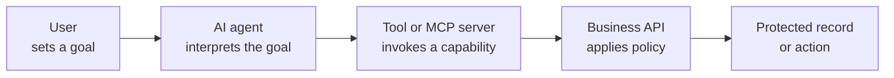
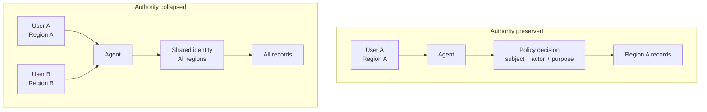
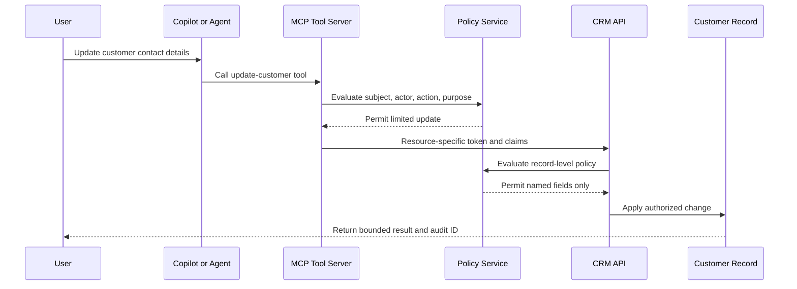
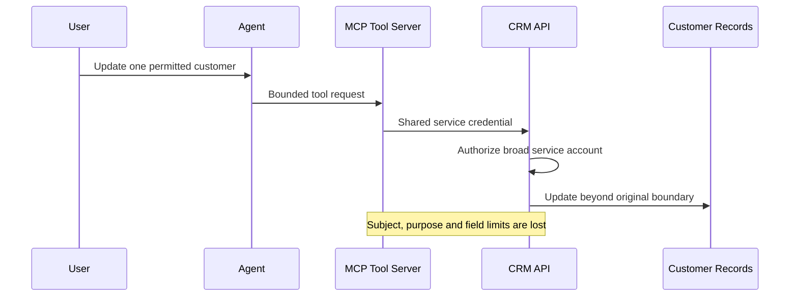
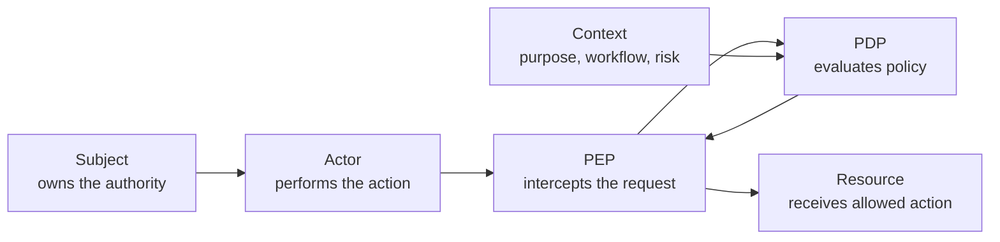
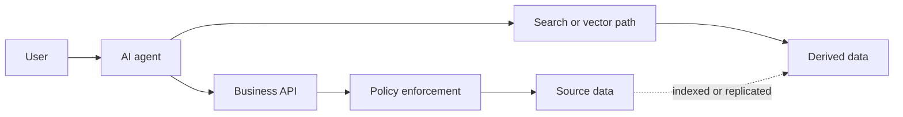

Short on time? >>

 agent -> tool -> API chain
4) The patterns that preserve authorization end to end, including PDP/PEP, resource-specific tokens, subject-and-actor claims and the alternate-path problem with search and vector stores
5) The one question a business leader should ask and the five measurements an architecture review should produce

Write it for business decision makers, security leaders and architects, and flag anything relevant to AI vendor risk, procurement, or governance decisions.">
  

    📍
    📋
  

  

    
<strong>Short on time?</strong> Summarize this article with

    

      <select class="ai-selector-dropdown" id="ai-platform-select">
        <option value="">-- Select an AI --</option>
        <option value="claude">🤖 Claude</option>
        <option value="chatgpt">✨ ChatGPT</option>
        <option value="gemini">🔮 Gemini</option>
        <option value="perplexity">🌐 Perplexity</option>
        <option value="copilot">⚡ Copilot</option>
      </select>
    

    
Your prompt is copied automatically — just paste it once the AI opens.

  

<blockquote class="prompt-info">

<strong>In short:</strong> An AI workflow can begin with a properly authenticated employee and still end in an action that employee was never allowed to perform. The failure is not a broken login; it is an agent, tool or backend quietly replacing a narrow authority with a broader one — most often a shared service account that every user's request collapses into. Authority may legitimately follow the user, belong to the agent, or transition between them under policy, but it must <em>never change silently</em>. In agentic systems, authorization is a property of the whole execution chain, not of the front door. The question for any leader deploying agents: <em>when an agent acts across several systems, can we prove the final action stayed within the authority of the user who asked, or of an explicitly approved agent mandate?</em>

</blockquote>

<blockquote>

<strong>Written for:</strong> Business decision makers, CISOs, identity leaders and security architects evaluating AI agents, tool integrations (including MCP) and multi-system automation.

</blockquote>

<blockquote>

<strong>Also worth reading:</strong> This post continues <a href="/posts/from-zero-trust-to-agent-trust/">The Digital Employee Nobody Hired: Why AI Agents Need Identities, Limits and an Off Switch</a>. That post asked whether an enterprise can identify, limit, supervise and stop its agents. This one follows an agent's authority <em>after</em> it starts to act.

</blockquote>

---

## Introduction

An employee asks an AI assistant to summarize delayed customer orders. The employee is authenticated. The assistant has a registered identity. Its tool server validates a token. The business API accepts a credential. Every component can truthfully say: *the request was authenticated.*

The result can still be unauthorized.

Suppose the employee may see orders for one region only, but the tool calls the business API with a shared identity that can read every region. No account was compromised and no authentication failed. The authorization boundary simply disappeared somewhere between the question and the data.

This post is about keeping that boundary intact while AI systems interpret goals, select tools and act across systems: the terms, the three legitimate ways authority can flow, the failure pattern, one chain that holds and one that breaks, and the patterns and review evidence that separate a design that is described from one that is demonstrated.

## One Request, Several Authorities

Each arrow may use a different identity, token, permission model and policy owner. Agent-identity systems such as Microsoft Entra Agent ID help by giving an agent its own identity, sponsor and lifecycle — but an identity alone does not say whether the agent is acting *for* a user, under its *own* mandate, or *through* a service with broader authority. The architecture has to make that explicit.

## Terms That Are Often Confused

Most confusion here comes from treating different things as one. *Identity propagation* carries who initiated an action to the next hop; it does not prove the action was permitted. *Delegation* lets one actor exercise bounded authority for another, and *impersonation* lets it act as if it were the subject — at the cost of audit visibility. **Authorization propagation** is the property this post is about: the applicable permissions and conditions survive every hop, whether or not the same credential does.
{: #authorization-terms }

A useful authorization decision needs five inputs — **the five elements** referred to throughout this post.
{: #five-elements }

**Table 1 — The five elements of an authorization decision and the question each answers.**

| Element | Meaning | Example question |
|---|---|---|
| **Subject** | Whose authority is being exercised | Is this allowed because *this employee* may do it, or because an approved agent mandate may? |
| **Actor** | Who is actually making the call | Which agent, tool or service holds the token and sends the request? |
| **Resource** | What is being accessed | Which record, document or transaction? |
| **Action** | Which operation is requested | Read, summarize, update, approve, execute? |
| **Context** | Conditions and declared purpose | Which workflow, risk state, device, approval? |

Subject and actor are the same thing only when a user calls an API directly, or when an autonomous agent runs under its own mandate. In the common case — an employee asks a copilot to do something — the subject is the employee and the actor is the agent. Keeping them separate is what lets the resource enforce the employee's limits *and* record that an agent, not the employee, performed the action.

OAuth gives you the plumbing for carrying that pair downstream. A token's audience says which service it is for, its scope says which operations it names, and RFC 8693 token exchange lets an agent obtain a token that carries both the user as subject and itself as actor. All of that is about the *token*. None of it knows anything about the *data*. A token scoped `customers.write` for the CRM says nothing about whether this employee may change this customer's bank details. **That record-level decision still has to be made by a policy that sees all five elements** — the token just delivers the inputs.

## Three Ways Authority Can Legitimately Flow

Authorization propagation does not mean every agent must inherit the end user's permissions. There are three legitimate models, and a well-governed estate uses all three.
{: #authority-models }

**Table 2 — The three authority models, when each fits, and what must be true for it to be safe.**

| Model | What it means | Fits | Safe only if |
|---|---|---|---|
| **User-delegated** | The agent acts for a user; the result must stay within that user's permissions | Assistants that search, summarize or update on an employee's behalf | The user's boundary is enforced at the resource, not merely logged |
| **Agent-owned** | An autonomous agent acts under its own approved mandate | Queue monitoring, reconciliation, scheduled processing | Permissions are scoped to the mandate, not borrowed from whoever triggered it |
| **Explicit transition** | A user starts a workflow; a controlled step hands execution to an agent or service mandate | Approval-then-execute workflows, hand-offs to back-office automation | The transition has a policy decision, defined scope, duration, evidence and — where warranted — an approver |

For the transition model, governance must answer who may approve it, which mandate is eligible, what stays prohibited, how long the authority lasts, and what triggers revocation.

The requirement is not *always preserve user authority*. It is:

> **Never allow authority to change silently.**

Forwarding the end-user identity to every hop creates coupling and cross-domain problems; a well-designed system will exchange credentials, transform claims or use an agent identity at different points. What must survive is the *meaning* of the authorization: who authorized the action, which authority is in use, what limits apply, and where the decision is enforced.

## The Authorization-Collapse Pattern

There is no standard name for what happened in the opening example, so I will call it **authorization collapse**: two or more principals with different permissions reach a resource through one intermediary that has more access than any of them, and their separate boundaries simply fold into its. It is the old confused-deputy weakness (CWE-441), except that in an agent pipeline the deputy is a tool server or a backend credential nobody thinks of as a decision point.
{: #authorization-collapse }

Service identities are not the problem; system-to-system work needs them. The problem is undocumented expansion of authority, or loss of attribution, at the point they are used. The test: **does the final action reflect the approved authority for this request, or merely the maximum authority of the intermediary?**

## One Chain That Holds, and the Same Chain Breaking

Consider a vendor-neutral pattern: an employee uses a copilot to update a customer's contact details through an MCP tool and a CRM API.

Distinct controls are at work: the agent has its own identity, so the actor stays visible; the MCP server accepts only the intended tool scope; a policy decision evaluates the five elements; the CRM enforces record- and field-level rules; and the audit record links user, agent, tool, decision and outcome. Any hand-off to an agent-owned mandate is represented explicitly, not hidden behind a backend credential.

### Where it breaks

The design fails if the MCP server ignores the bounded decision and calls the CRM with a shared service account that can update every customer and field. The CRM then authorizes the *service account*, not the employee-agent request. Subject, purpose and field limits become audit metadata — present in the logs, absent from the decision. That is the point of collapse.

## Where the Decision Is Made: PDP and PEP

Authorization does not have to be reimplemented inside every application. Modern architectures separate a **Policy Decision Point (PDP)**, which evaluates policy, from a **Policy Enforcement Point (PEP)**, which allows, modifies or blocks the request. NIST SP 800-207 describes both as core Zero Trust components; SP 800-207A applies them to identity-tier policy in cloud-native applications.

A PDP may be embedded or central, and may implement RBAC, ABAC, relationship-based (ReBAC, Zanzibar-style) or capability-based models. The important property is not *centralized versus distributed*. It is that the decision has reliable five-element inputs, enforcement covers every consequential path, no other tool or data copy bypasses it, and the resource never accepts authority broader than the decision intended.

Two cautions. A central authorization service is a critical dependency: it needs availability, protected policy administration, versioned decisions and an explicit fail-open or fail-closed stance per process. And runtime tool discovery — an agent finding a new MCP capability on the fly — must not bypass registration, policy evaluation or enforcement because the capability is new.

## Patterns That Preserve Authorization

No single pattern fits every workflow. These **preservation patterns** combine.
{: #preservation-patterns }

**Table 3 — Eight preservation patterns, what each does, and the failure it prevents.**

| Pattern | What it does | Prevents |
|---|---|---|
| **1. Resource-specific, delegated tokens** | Issue tokens for the intended downstream audience, constrained to necessary operations | Token forwarding to services it was never issued for |
| **2. Subject-and-actor representation** | Carry both the originating subject and the acting agent or service | Losing attribution; pretending agent and user are one actor |
| **3. Bounded claims transformation** | Translate claims between systems only through an approved trust relationship; narrow or preserve, never widen | Silent privilege expansion at a trust boundary |
| **4. External policy decisions** | PDP/PEP where consistent policy is needed across many tools and APIs | Inconsistent or missing decisions across the estate |
| **5. Resource- and field-level authorization** | Apply rules at tenant, record, field, operation and transaction-value granularity | "API access" implying access to every object behind the API |
| **6. Purpose as policy context** | For higher-risk workflows, declared purpose — tied to a controlled workflow and policy version — augments identity, resource and action checks | Legitimate access used for an unapproved purpose |
| **7. Continuous authorization and revocation** | Re-evaluate on change of risk, device, session or agent behaviour; revocation reaches tokens, caches, indexes and running workflows within a known period; long tasks re-authorize at checkpoints | Authority outliving the decision that granted it |
| **8. Cross-domain and agent-to-agent brokerage** | At every organizational, SaaS or agent boundary: explicit token exchange, audience restriction and local policy evaluation; delegation to another agent is a *new bounded decision* | Collapse across trust domains and multi-agent pipelines |

Pattern 8 matters more as agent-to-agent orchestration becomes routine: when agent A hands a task to agent B, B's authority is the intersection of what the request needs and what B is approved to do — not whatever A happened to hold.

## The Alternate-Path Problem

Search indexes, caches, embeddings, replicas and vector stores are each a second route to the same information — and a second authorization path.

Permission parity with the source is necessary but not always sufficient: embeddings, chunk metadata, summaries and combined retrieval can reveal inferences not obvious in any single record the user may open. A review tests both **access equivalence** (same objects by either path?) and **information revealed by retrieval and composition** (can the user *learn* more by this path?).

A new retrieval path is a new authorization path.

## Common Anti-Patterns

- **Shared service accounts** — users and agents become indistinguishable at the resource; the canonical collapse.
- **Static API keys and long-lived tokens reused across tools** — no user or agent context, and one durable credential outlives the task.
- **Blanket backend permissions** — the tool reaches more than any approved workflow requires.
- **Unscoped tool credentials** — a credential for one tool or audience reused elsewhere.
- **Prompt-only restrictions** — instructions ask the agent to behave but enforce nothing.
- **Unsynchronized derived stores** — source access revoked while the index or vector store still answers.
- **Self-approved scope expansion** — the agent can request more authority without an independent decision.

## What an Architecture Review Should Measure

A review should produce evidence, not only a diagram. These are dimensions, not thresholds; acceptable values depend on the data, action, regulatory context and impact of failure.
{: #review-measures }

**Table 4 — Five review measures, why each matters, and how to obtain it.**

| Measure | Why it matters | How to measure |
|---|---|---|
| **Revocation latency** | How long removed authority stays usable | Revoke a test subject or agent; time to denial across API, cache, search and active-workflow paths |
| **Authorization coverage %** | Consequential paths with no enforceable decision | Paths with a tested PDP/PEP decision ÷ all in-scope consequential paths |
| **Privilege-expansion count** | Where effective authority becomes broader | Count hops where downstream permissions exceed incoming authority; each approved expansion needs an owner and a policy reference |
| **Alternate-path parity** | Whether equivalent routes give equivalent outcomes | Run one allow/deny test set against API, search, cache and vector paths; record pass, fail or justified exception |
| **Decision traceability** | Investigation, audit, accountability | Sample material actions; reconstruct subject, actor, policy version, resource, action, context and outcome |

Run against the broken CRM chain, three of the five fail at once: coverage (the CRM's decision ignores the request's subject), privilege expansion (one unowned hop from "one customer, named fields" to "all customers, all fields") and traceability (the log shows a service account, not the employee or agent). That is the business impact in miniature: unauthorized change or exposure, a segregation-of-duties gap, and an audit that cannot say who authorized what.

## What Business Leaders Should Ask

The primary question:

> **When an AI agent acts across several systems, can we prove that the final action remained within the authority of the originating user or an explicitly approved agent mandate?**

Then five follow-ups:

1. Where in the chain can a limited authority be replaced by a broader service identity, and who owns each such point?
2. When does authority transition from the user to the agent, and who approved it?
3. Can the same information be reached through an API, an index, a cache or a vector store — and do all routes agree?
4. Can a tool or agent increase its own scope during execution?
5. When access is revoked, how quickly does *every* route stop working, and what test evidence shows it?

For vendor review: **does the vendor explain only how identities authenticate, or can it show how authority is constrained through its tools and downstream systems?**

## Conclusion

Agentic AI turns one request into a chain of actions by several identities across several systems. Authority may follow the user, belong to the agent, or transition between them under policy — provided the transition is explicit, constrained and auditable. Authentication establishes who is present; delegation explains who acts for whom; authorization constrains what may happen; decision and enforcement points keep those limits effective across the chain.

An AI agent should not gain authority merely because it is useful, connected, or operating through an authenticated tool. **Its authorization must survive the entire execution chain.**

## Key Takeaways

- Valid authentication at every hop does not prove the final action was authorized.
- Authority may follow the user or belong to an agent, but it must never change silently.
- *Authorization collapse* — distinct boundaries disappearing behind a broader intermediary identity — is the pattern to look for; a shared service account behind a tool is its most common form.
- PDP/PEP and resource-local authorization are both valid when decisions use the five elements and enforcement covers every path, including derived data stores and dynamically discovered tools.
- The decisive evidence is revocation latency, alternate-path parity and the ability to reconstruct the authorization decision end to end.

> 💡 **Pro Tip:** Pick one high-value AI workflow and write the identity, the authority and the enforcement point above every arrow in its diagram. If two principals with different permissions become the same broad identity before the protected action, you have found your first review priority.



---



---

## References

- [NIST SP 800-207 — Zero Trust Architecture](https://csrc.nist.gov/pubs/sp/800/207/final) — policy decision and enforcement points as core Zero Trust components
- [NIST SP 800-207A — A Zero Trust Architecture Model for Access Control in Cloud-Native Applications in Multi-Location Environments](https://csrc.nist.gov/pubs/sp/800/207/a/final) — identity-tier policies and application-level access control
- [NIST SP 800-162 — Guide to Attribute Based Access Control (ABAC)](https://csrc.nist.gov/pubs/sp/800/162/upd2/final) — subject, object, operation and environment attributes
- [NIST SP 800-53 Rev. 5 — AC-6 Least Privilege](https://csrc.nist.gov/pubs/sp/800/53/r5/upd1/final) — least-privilege control guidance
- [RFC 8693 — OAuth 2.0 Token Exchange](https://www.rfc-editor.org/rfc/rfc8693.html) — delegation, subject and actor representation, audience-scoped tokens
- [MITRE CWE-441 — Unintended Proxy or Intermediary ('Confused Deputy')](https://cwe.mitre.org/data/definitions/441.html) — the weakness class that authorization collapse instantiates at scale
- [Model Context Protocol — Authorization (2025-06-18 specification)](https://modelcontextprotocol.io/specification/2025-06-18/basic/authorization) — OAuth-based authorization responsibilities for HTTP-based MCP clients and servers
- [OWASP Top 10 for Agentic Applications 2026](https://genai.owasp.org/resource/owasp-top-10-for-agentic-applications-for-2026/) — excessive agency and related agent-specific failure modes
- [Microsoft Entra Agent ID — Overview of Agent Identities](https://learn.microsoft.com/en-us/entra/agent-id/agent-identities) — agent identity, sponsor and lifecycle concepts
- [Open Policy Agent Documentation](https://www.openpolicyagent.org/docs/latest/) — a general-purpose policy engine and PDP approach
- [Cedar Policy Language](https://www.cedarpolicy.com/en) — a policy language for fine-grained authorization
- [The Digital Employee Nobody Hired: Why AI Agents Need Identities, Limits and an Off Switch](/posts/from-zero-trust-to-agent-trust/)
- [Who Processes the Data? Trust, Responsibility, and AI Inference Beyond the Cloud](/posts/who-processes-the-data-ai-trust-boundary/)

---

## Disclaimer

This article describes general security-architecture patterns using illustrative and composite examples. "Authorization collapse" is proposed as an analytical label, not an established standard or industry classification; the argument is risk-based rather than statistical, as reliable cross-industry incident data for this specific failure pattern remains limited. No specific employer, customer, vendor implementation, security finding, vulnerability or incident is referenced or implied. Technology capabilities and specifications evolve; readers should validate current authoritative documentation. This content is not legal, compliance or risk advice and does not represent the position of any employer, vendor, regulator or standards body.
